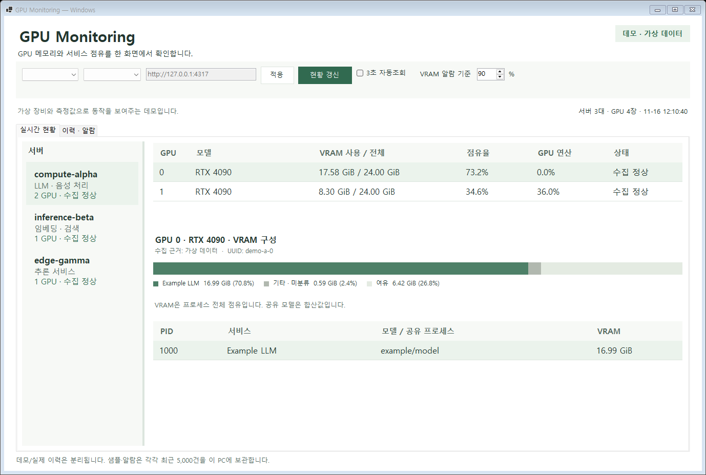
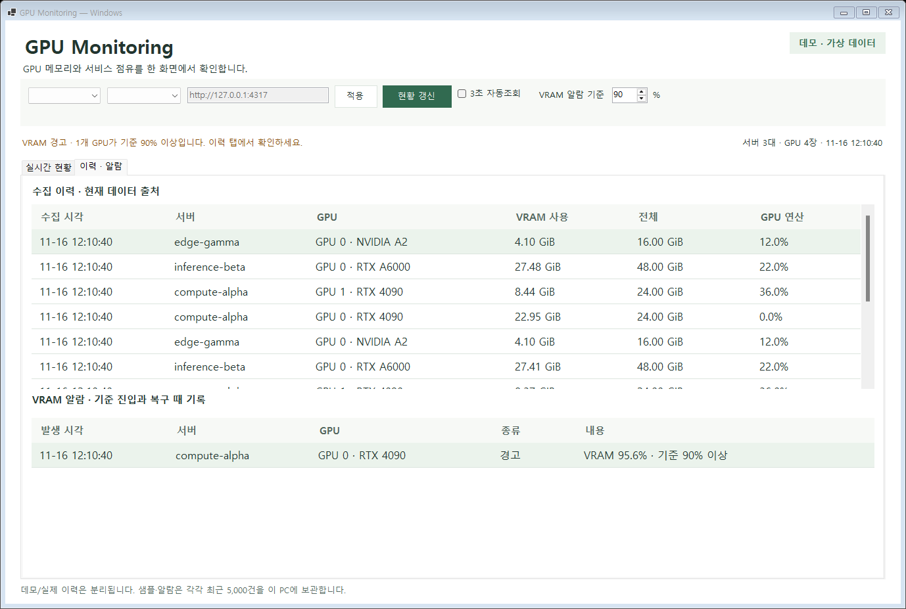

# GPU Monitoring

**C# / .NET 8 / Windows Forms / SQLite**

서버와 GPU별 메모리 사용량, 연산 사용률, 실행 프로세스를 확인하는 Windows 데스크톱 프로젝트입니다. 비동기 JSON API 연동과 로컬 수집 이력, VRAM 임계값 알람을 구현했습니다.



## 주요 기능

- 서버·GPU 선택과 프로세스별 VRAM 구성 표시
- GPU 연산 사용률과 VRAM 점유율을 별도로 표시
- 미측정·연결 실패와 실제 0을 구분하고, 오래된 응답은 상태를 명시
- HttpClient 비동기 조회·취소·시간 제한과 자동 조회 일시 정지
- SQLite 수집 이력, 같은 스냅샷의 중복 기록 방지
- VRAM 임계값 진입·복구 알람, 데모/API 출처별 이력 분리
- GPU 없는 PC에서도 실행되는 가상 서버 3대·GPU 4장 데모

이 프로젝트는 **모니터링 클라이언트**입니다. 실제 측정은 [JSON API 규격](docs/api.md)을 따르는 별도 로컬 수집 API에 연결합니다. 앱 안에 SSH 인증이나 NVIDIA 드라이버 제어 기능은 포함하지 않습니다. 기본 데모는 외부 서비스 없이 실행됩니다.

## 실행

Windows와 .NET 8 SDK가 필요합니다.

```powershell
dotnet run --project src/GpuMonitoring.Windows
```

처음 실행하면 `데모 데이터 / 일반`으로 시작합니다. 서버와 GPU를 선택해 상세 점유를 보고, 시나리오를 `메모리 경고`나 `수집 실패`로 바꾸면 알람과 미측정 처리를 확인할 수 있습니다.

`로컬 API`를 선택하고 API 주소를 입력한 뒤 `적용`하면 실제 연동 모드로 바뀝니다. loopback HTTP 주소만 허용합니다. 자동 조회는 `/api/state`를 읽고, `현황 갱신` 버튼만 새 수집을 요청합니다.

## 데이터 해석

| 표시 | 의미 |
| --- | --- |
| GPU 연산 | 해당 시점의 연산 사용률. VRAM이 차 있어도 0%일 수 있습니다. |
| 프로세스 점유 | 해당 GPU 프로세스의 VRAM 합계. 여러 모델을 실행하면 모델별 개별 사용량이 아닙니다. |
| 기타·미분류 | GPU 전체 사용량에서 분류한 프로세스 합계를 뺀 값 |
| 여유 | 전체 VRAM에서 사용량을 뺀 값 |
| 확인 불가 | 미수집·미지원·오프라인. 0으로 대체하지 않습니다. |
| 이전 응답 | API 요청 실패 후 마지막으로 받은 응답을 표시하는 상태 |

전체 용량보다 사용량이 크거나 프로세스 합계가 전체 사용량보다 크면 비율을 임의로 맞추지 않습니다.

## 이력과 알람



`%LOCALAPPDATA%/GpuMonitoring.Windows/history.db`에 저장합니다. 이력 탭은 최근 250건을 조회하고 샘플·알람 테이블은 각각 최근 5,000건을 보관합니다. 데모와 API 주소별로 이력을 구분합니다. 알람은 기준 진입과 복구 때 기록하며, 측정값이 사라졌다고 복구 처리하지 않습니다. 설정값은 재실행 시 기본값으로 돌아갑니다.

실제 API를 연결하면 장비명과 측정값도 로컬 DB에 저장됩니다. 저장소에는 운영 DB와 접속정보를 포함하지 않습니다. 위 사진의 장비와 측정값은 모두 가상입니다. WinForms 캡처 방식 때문에 사진에서 콤보박스의 선택 글자가 생략될 수 있으며 실제 화면에서는 표시됩니다.

## 구조

```text
src/GpuMonitoring.Core       JSON 해석 · VRAM 계산 · HTTP · SQLite
src/GpuMonitoring.Windows    WinForms UI · 비동기 갱신 · 데모
tests/GpuMonitoring.Tests    SQLite·HTTP를 포함한 행동 테스트
examples/state.json         가상 API 응답
docs/api.md                 연동 규격
docs/verification.md        확인한 동작과 검증 한계
```

## 테스트와 빌드

```powershell
dotnet run --project tests/GpuMonitoring.Tests --configuration Release
dotnet build src/GpuMonitoring.Windows --configuration Release
dotnet publish src/GpuMonitoring.Windows --configuration Release --runtime win-x64 --self-contained true -p:PublishSingleFile=true -p:IncludeNativeLibrariesForSelfExtract=true -p:EnableCompressionInSingleFile=true --output artifacts/publish
```

자체 포함 게시 결과는 `artifacts/publish/GpuMonitoring.Windows.exe`입니다. 이 파일은 별도의 .NET 런타임 설치 없이 실행되며 관리자 권한이 필요하지 않습니다. SQLite 네이티브 라이브러리는 사용자 임시 경로로 추출됩니다.

```powershell
.\artifacts\publish\GpuMonitoring.Windows.exe --smoke-test artifacts/qa
```

smoke 모드는 별도 가상 DB로 UI 시나리오를 확인하고 JSON 결과와 PNG를 저장한 뒤 종료합니다. 실제 운영 서버를 호출하지 않습니다.

AI 코딩 도구를 활용해 구현했습니다. 개인 프로젝트이며 실제 GPU·장비 운영 환경의 통합 검증과 장시간 부하 검증은 별도입니다.
